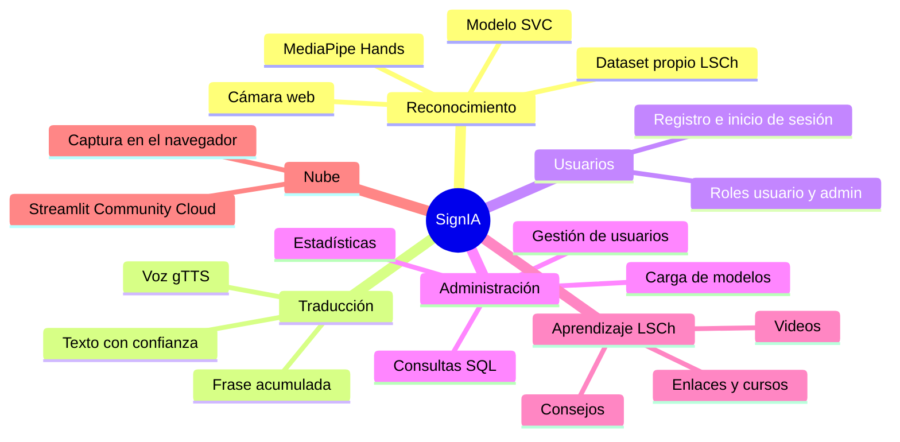
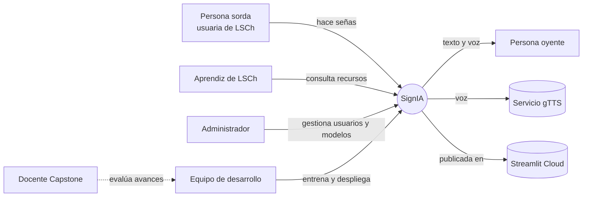
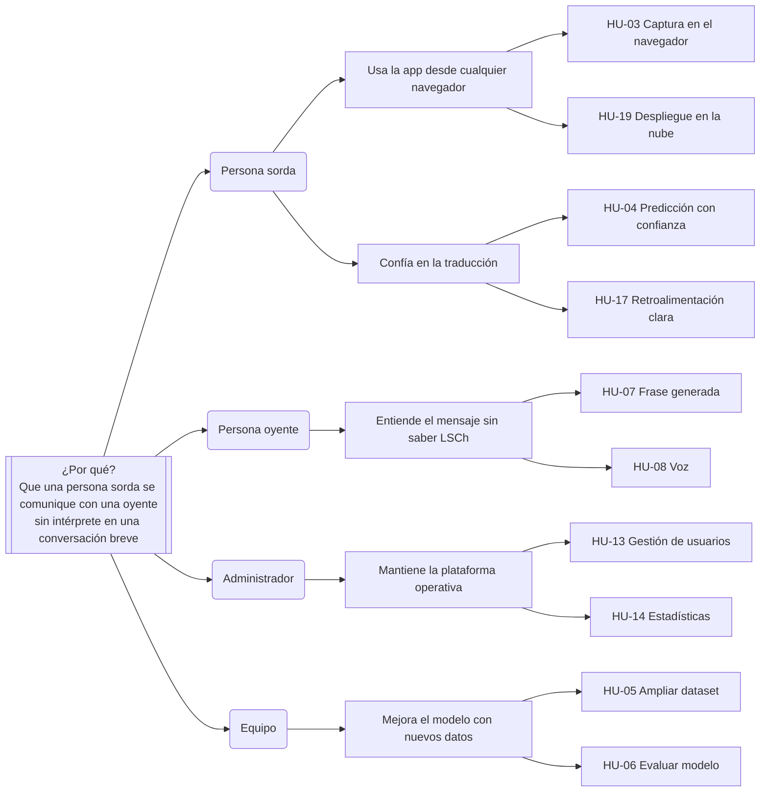

# Mapas del producto: SignIA

Artefactos de planificación visual creados en los Sprints 1 y 2. Los diagramas usan Mermaid, que GitHub muestra como imagen.

## 1. Mapa mental

## 2. Mapa de actores

| Actor | Tipo | Interés |
| --- | --- | --- |
| Persona sorda | Primario | Comunicarse sin intérprete |
| Persona oyente | Primario | Entender a la persona sorda |
| Aprendiz de LSCh | Secundario | Aprender y practicar |
| Administrador | Secundario | Operar la plataforma |
| Equipo de desarrollo | Interno | Construir y mejorar el producto |
| Docente | Externo | Evaluar el proyecto APT |
| gTTS y Streamlit Cloud | Sistemas externos | Voz y hosting |

## 3. Impact Mapping

Conecta el objetivo con los actores, los cambios de comportamiento esperados (impactos) y las funcionalidades (entregables).

## 4. User Story Map

La fila superior es el recorrido del usuario (actividades). Debajo, las historias ordenadas por prioridad; cada franja horizontal es una entrega (release).

| | Acceder | Preparar cámara | Hacer señas | Comunicar | Aprender | Administrar |
| --- | --- | --- | --- | --- | --- | --- |
| **Release 1: MVP local (Fase 1)** | HU-10 Registro HU-11 Inicio de sesión | HU-02 Detectar manos | HU-04 Predicción con confianza | HU-07 Frase HU-08 Voz HU-09 Limpiar | HU-22 Recursos LSCh | HU-13 Usuarios HU-15 Cargar modelo |
| **Release 2: Nube (Sprints 3 y 4)** | HU-12 Contraseñas seguras | HU-03 Cámara en el navegador HU-01 Entorno reproducible | HU-05 Más vocabulario HU-06 Modelo evaluado | HU-19 URL pública | | |
| **Release 3: Experiencia (Sprints 5 y 6)** | HU-16 Interfaz consistente | HU-17 Retroalimentación | | HU-23 Voz a texto | HU-18 Alto contraste | HU-14 Estadísticas corregidas |
| **Release 4: Calidad (Sprints 7 y 8)** | | | HU-20 Pruebas unitarias | HU-21 Validación con usuarios | | |
