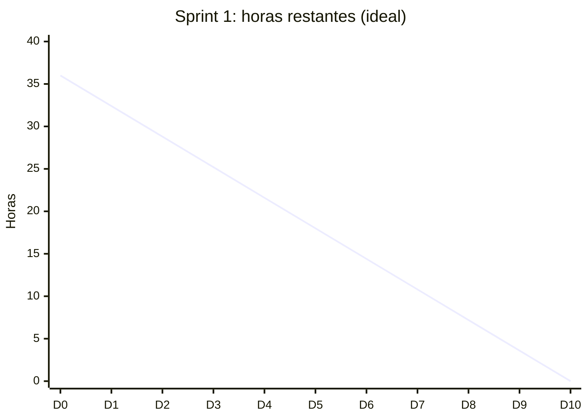

# Sprint 1: Documentación y definición

| Campo | Detalle |
| --- | --- |
| Semanas | 1 y 2 (Fase 1) |
| Responsable | Khaeil Parga (Product Owner) |
| Sprint Goal | Definir el proyecto y su Product Backlog inicial |
| Capacidad | 3 personas × 6 h por semana × 2 semanas = 36 h |
| Estado | Cerrado (documentado retroactivamente al inicio de la Fase 2) |

## 1. Sprint Planning: Sprint Backlog

| ID | Tarea | Relacionada con | Responsable | Estimación (h) | Estado |
| --- | --- | --- | --- | --- | --- |
| T1.1 | Redactar fundamentación y relevancia del proyecto (Guía 1.5) | Visión | Khaeil Parga | 4 | Hecho |
| T1.2 | Definir objetivo general y específicos | Visión | Equipo | 3 | Hecho |
| T1.3 | Definir metodología, roles Scrum y Definition of Done | Proceso | Franco Duarte | 3 | Hecho |
| T1.4 | Elaborar plan de trabajo y Carta Gantt | Planificación | Khaeil Parga | 4 | Hecho |
| T1.5 | Redactar visión del producto | `01_vision/` | Khaeil Parga | 3 | Hecho (Fase 2) |
| T1.6 | Definir épicas e historias de usuario priorizadas | `02_backlog/` | Equipo | 6 | Hecho (Fase 2) |
| T1.7 | Elaborar Impact Map | `03_mapas/` | Franco Duarte | 3 | Hecho (Fase 2) |
| T1.8 | Autoevaluaciones y diarios de reflexión individuales | Evidencias individuales | Cada integrante | 6 | Hecho |
| T1.9 | Presentación de Fase 1 | Evidencia grupal | Equipo | 4 | Hecho |
| | **Total** | | | **36** | |

## 2. Scrumboard al cierre

| Por hacer | En curso | En revisión | Hecho |
| --- | --- | --- | --- |
| | | | T1.1 a T1.9 |

## 3. Burndown

Horas restantes planificadas (línea ideal). Las horas reales no se registraron en la Fase 1; desde el Sprint 3 se registran día a día.

## 4. Sprint Review

- **Incremento:** guía de definición del proyecto (1.5), presentación de Fase 1 y evidencias individuales en el repositorio Capstone.
- **Retroalimentación:** la presentación quedó débil: diapositivas solo de imagen, sin backlog ni historias de usuario, y con tecnologías (Keras) distintas a las implementadas (SVC).
- **Ajustes al backlog:** se agregan las historias de despliegue en la nube (HU-19), captura en el navegador (HU-03) y UX/UI (HU-16, HU-17).

## 5. Retrospectiva

| Qué funcionó | Qué no funcionó | Acción de mejora |
| --- | --- | --- |
| Roles Scrum claros desde el inicio | La documentación no reflejó el código real | Revisar cada documento contra el código antes de entregar |
| Se cumplió con todas las evidencias individuales | No hubo backlog ni historias de usuario formales | Mantener el backlog en el repositorio y actualizarlo en cada review |
| | No se registró el avance diario | Registrar dailies y burndown desde el Sprint 3 |
