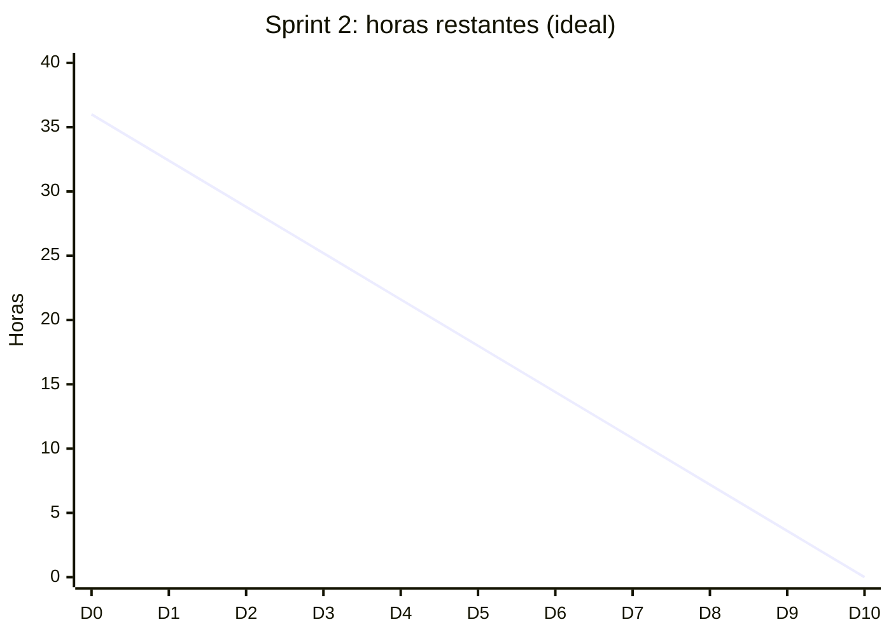

# Sprint 2: Arquitectura y diseño

| Campo | Detalle |
| --- | --- |
| Semanas | 3 y 4 (Fase 1) |
| Responsable | Equipo |
| Sprint Goal | Definir la arquitectura, el modelo de datos y la nueva interfaz |
| Capacidad | 36 h |
| Estado | Parcial (documentado retroactivamente al inicio de la Fase 2): la arquitectura está documentada; mockups, guía de estilo y plan de pruebas pasan al Sprint 3 |

## 1. Sprint Planning: Sprint Backlog

| ID | Tarea | Relacionada con | Responsable | Estimación (h) | Estado |
| --- | --- | --- | --- | --- | --- |
| T2.1 | Documentar stack tecnológico y arquitectura actual | `04_arquitectura/` | Khaeil Parga | 4 | Hecho |
| T2.2 | Diseñar arquitectura objetivo para la nube | `04_arquitectura/` | Franco Duarte | 4 | Hecho |
| T2.3 | Modelo de datos (usuarios, sesiones, predicciones) | `04_arquitectura/` | Khaeil Parga | 3 | Hecho |
| T2.4 | User Story Map y mapa de actores | `03_mapas/` | Franco Duarte | 3 | Hecho |
| T2.5 | Mockups de login, traductor y panel admin en Figma | HU-16 | Franco Duarte | 8 | Por hacer |
| T2.6 | Guía de estilo: paleta, tipografía, botones | HU-16 | Franco Duarte | 4 | Por hacer |
| T2.7 | Revisar criterios de aceptación con el PO | Backlog | Khaeil Parga | 2 | Hecho |
| T2.8 | Plan de pruebas inicial | HU-20 | Joaquín González | 4 | Por hacer |
| T2.9 | Informe de avance Fase 1 | Evidencia | Equipo | 4 | Hecho |
| | **Total** | | | **36** | |

## 2. Scrumboard al cierre

| Por hacer | En curso | En revisión | Hecho |
| --- | --- | --- | --- |
| T2.5 Mockups T2.6 Guía de estilo T2.8 Plan de pruebas | | | T2.1, T2.2, T2.3, T2.4, T2.7, T2.9 |

## 3. Burndown

Quedan 16 h sin terminar (T2.5, T2.6, T2.8), que pasan al Sprint 3.

## 4. Sprint Review

- **Incremento:** arquitectura actual y objetivo, modelo de datos y mapas en el repositorio.
- **Decisión:** se mantiene el clasificador SVC (no Keras) y se agrega `streamlit-webrtc` para capturar la cámara en el navegador.
- **Pendiente:** mockups y guía de estilo; sin ellos no se puede empezar el rediseño de la interfaz del Sprint 5.

## 5. Retrospectiva

| Qué funcionó | Qué no funcionó | Acción de mejora |
| --- | --- | --- |
| Tener el MVP funcionando acelera la arquitectura | Los mockups quedaron para el final del sprint | Diseñar primero la pantalla del traductor, que es la más usada |
| Las decisiones técnicas quedaron escritas | No hay plan de pruebas | Joaquín arma el plan de pruebas en el Sprint 3 |
