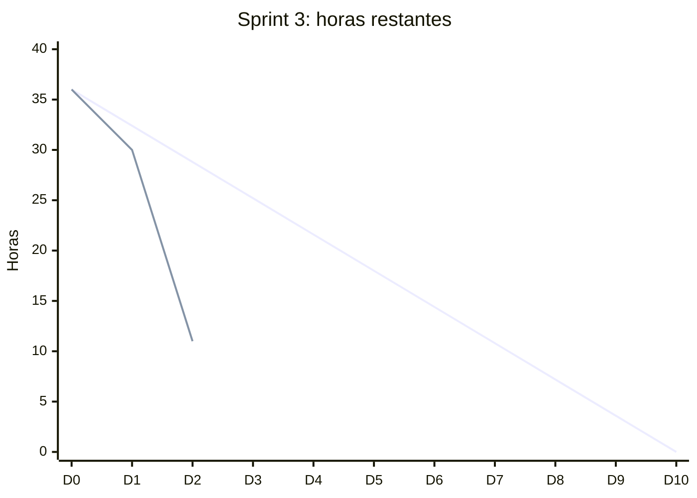

# Sprint 3: Entorno base y captura de video

| Campo | Detalle |
| --- | --- |
| Semanas | 5 y 6 (Fase 2) |
| Responsable | Franco Duarte |
| Sprint Goal | Tener un entorno reproducible y la cámara capturada desde el navegador, con el acceso de usuarios corregido y seguro |
| Capacidad | 3 personas × 6 h por semana × 2 semanas = 36 h |
| Historias | HU-01, HU-02, HU-03, HU-10, HU-11, HU-12, y lo pendiente del Sprint 2 (HU-16 mockups) |
| Estado | Código terminado; quedan los mockups y la prueba en Chrome y Edge con el equipo |

## 1. Sprint Planning: Sprint Backlog

| ID | Tarea | HU | Responsable | Estimación (h) | Estado |
| --- | --- | --- | --- | --- | --- |
| T3.1 | Crear repositorio SignIA-APT con estructura por fases | HU-01 | Franco Duarte | 2 | Hecho |
| T3.2 | Entorno Python 3.10 reproducible e instrucciones en el README | HU-01 | Franco Duarte | 2 | Hecho |
| T3.3 | Prueba de humo de la versión 1.0 | HU-02 | Franco Duarte | 2 | Hecho |
| T3.4 | Mockups del login, traductor y panel admin (pendiente Sprint 2) | HU-16 | Franco Duarte | 6 | Por hacer |
| T3.5 | Cámara del navegador con `streamlit-webrtc`, manteniendo la cámara local como respaldo | HU-03 | Franco Duarte | 8 | Hecho |
| T3.6 | Corregir conversión de `expires_at` al cargar sesiones | HU-11 | Khaeil Parga | 1 | Hecho |
| T3.7 | Corregir el formulario de registro, mostrar confirmación y botones visibles | HU-10, HU-16 | Joaquín González | 2 | Hecho |
| T3.8 | Hash de contraseñas con sal y admin inicial desde `st.secrets` | HU-12 | Khaeil Parga | 4 | Hecho |
| T3.9 | Plan de pruebas inicial y primeras pruebas unitarias (`tests/`) | HU-20 | Joaquín González | 4 | Hecho |
| T3.10 | Probar captura y predicción en Chrome y Edge | HU-03 | Joaquín González | 3 | En curso |
| T3.11 | Review, retrospectiva y actualización del backlog | — | Equipo | 2 | Por hacer |
| | **Total** | | | **36** | |

## 2. Scrumboard

Actualizar en cada daily. Herramienta: GitHub Projects (o Trello), con estas mismas columnas.

| Por hacer | En curso | En revisión | Hecho |
| --- | --- | --- | --- |
| T3.4, T3.11 | T3.10 | | T3.1, T3.2, T3.3, T3.5, T3.6, T3.7, T3.8, T3.9 |

## 3. Burndown

Completar la fila "Real" al final de cada día con las horas que quedan.

| Día | D0 | D1 | D2 | D3 | D4 | D5 | D6 | D7 | D8 | D9 | D10 |
| --- | --- | --- | --- | --- | --- | --- | --- | --- | --- | --- | --- |
| Ideal | 36 | 32,4 | 28,8 | 25,2 | 21,6 | 18 | 14,4 | 10,8 | 7,2 | 3,6 | 0 |
| Real | 36 | 30 | 11 | | | | | | | | |

## 4. Registro de dailies

Cada integrante responde: qué hice, qué haré, qué me bloquea.

| Día | Integrante | Qué hice | Qué haré | Impedimentos |
| --- | --- | --- | --- | --- |
| D1 | Franco Duarte | Creé el repo nuevo, el entorno y probé la versión 1.0 | Mockups y captura con webrtc | Ninguno |
| D1 | Khaeil Parga | | | |
| D1 | Joaquín González | | | |
| D2 | Franco Duarte | Cámara del navegador, correcciones de login y registro, contraseñas seguras y pruebas unitarias | Probar la cámara del navegador en Chrome y Edge con el equipo; mockups | Ninguno |

## 5. Sprint Review

Completar al cierre.

- **Incremento entregado:**
- **Demostración:** traductor funcionando con la cámara del navegador.
- **Historias aceptadas por el PO:**
- **Historias no terminadas y motivo:**
- **Cambios al Product Backlog:**

## 6. Retrospectiva

| Qué funcionó | Qué no funcionó | Acción de mejora |
| --- | --- | --- |
| | | |

## Criterio de éxito del sprint

El sprint se cumple si un usuario puede iniciar sesión y traducir señas con la cámara del navegador, en local, sin credenciales por defecto en el código.
