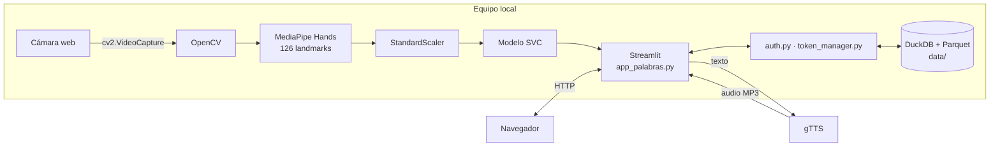
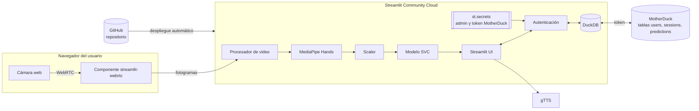
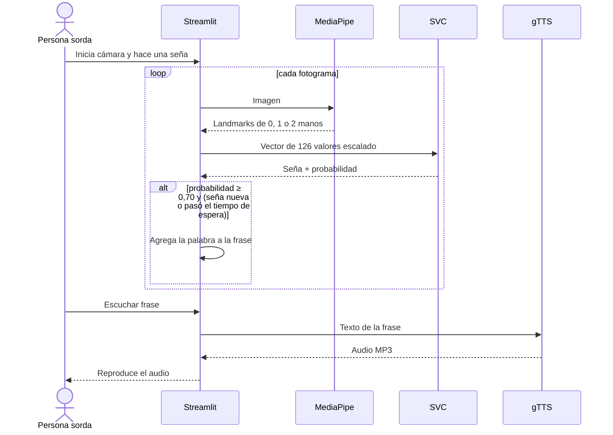
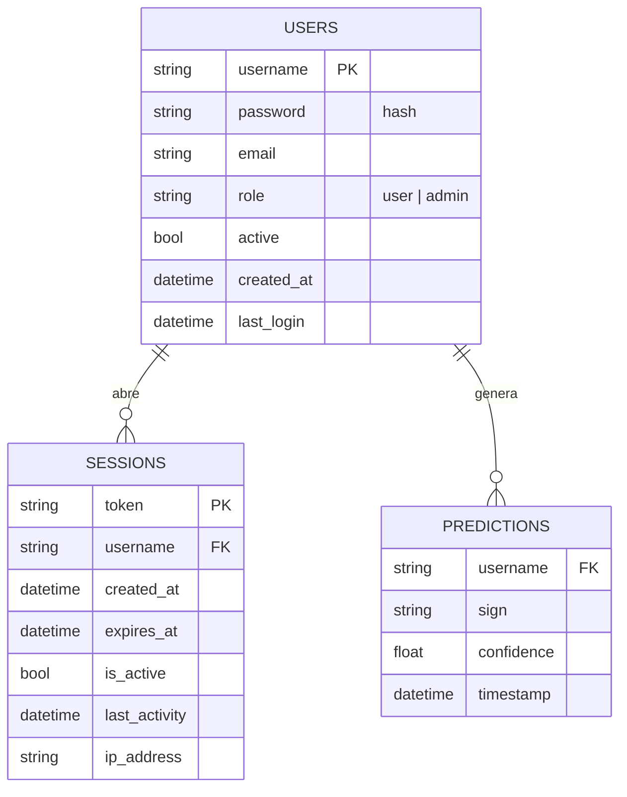

# Arquitectura y modelo de datos: SignIA

Documento transversal con diseño emergente: se crea en el Sprint 2 y se actualiza en cada sprint. Cada versión registra qué cambió.

| Versión | Sprint | Cambio |
| --- | --- | --- |
| 1.0 | 2 | Arquitectura de la versión 1.0 local |
| 1.1 | 3 | Captura en el navegador implementada (`app/recognizer.py`, `streamlit-webrtc`), contraseñas PBKDF2 |
| 1.2 | 4 | Archivos de despliegue para Streamlit Community Cloud, gestión de secretos y entrenamiento desde la web |
| 1.3 | 5 | Nueva interfaz: tema visual y componentes en `app/ui.py`, menú lateral por rol, páginas sin emojis |
| 1.4 | 6 | Persistencia en MotherDuck (DuckDB en la nube) activable con un token en `st.secrets` |

## 1. Stack tecnológico

Stack del proyecto.

| Capa | Tecnología | Uso |
| --- | --- | --- |
| Interfaz y servidor | Streamlit 1.45, Plotly | Páginas, formularios y gráficos |
| Visión por computador | OpenCV 4.11, MediaPipe 0.10.21 | Captura y 21 puntos por mano (hasta 2 manos) |
| Clasificación | scikit-learn 1.6.1 (SVC RBF + StandardScaler) | 126 características → 18 señas |
| Voz | gTTS 2.5 | Texto a voz en español (requiere Internet) |
| Datos | DuckDB 1.5, Parquet (pandas, PyArrow) | Usuarios, sesiones y predicciones |
| Lenguaje | Python 3.10 | Todo el proyecto |
| Nube | Streamlit Community Cloud (gratuito) | Despliegue desde GitHub |

## 2. Arquitectura v1.0 (local)

**Limitación clave:** la cámara la abre el proceso de Python con `cv2.VideoCapture(0, cv2.CAP_DSHOW)`. Funciona solo si el navegador y el servidor están en el mismo equipo Windows. En la nube no hay cámara.

## 3. Arquitectura objetivo (v1.1, nube)

Decisiones:
- **Captura con `streamlit-webrtc`:** el navegador envía los fotogramas al servidor; el resto del pipeline no cambia. Alternativa descartada: MediaPipe en JavaScript, porque obliga a reescribir la extracción de landmarks y a mantener dos lenguajes.
- **Modelo SVC en vez de red neuronal:** pesa poco, predice en milisegundos en CPU y ya alcanza 98,7 % en los datos de prueba. Se compararán alternativas en el Sprint 4 solo si las métricas con usuarios nuevos lo justifican.
- **Secretos:** la contraseña del administrador inicial sale de `st.secrets`, no del código.
- **Persistencia:** el disco del plan gratuito es efímero, por lo que los datos no pueden vivir en archivos. Se usa **MotherDuck** (DuckDB en la nube, plan gratuito): mantiene el mismo motor y SQL, y solo cambia la conexión en `app/utils.py`. Si `MOTHERDUCK_TOKEN` está en `st.secrets`, las tablas viven en MotherDuck y las predicciones se agregan con `INSERT`; sin token, la app usa archivos Parquet en `data/` (modo local). La primera conexión crea las tablas y sube los datos locales que existan. Alternativa descartada: Supabase (PostgreSQL), porque obliga a reescribir las consultas y la capa de datos.

## 4. Componentes

| Módulo | Responsabilidad |
| --- | --- |
| `app/app_palabras.py` | Páginas del usuario y del administrador, selección de cámara, frase y voz |
| `app/ui.py` | Sistema de diseño (tokens de color, tipografía, espaciado y movimiento; ver `docs/fase2/06_diseno/sistema_de_diseno.md`) y componentes: encabezados, tarjetas, menú lateral, tarjeta de predicción y globo de la frase |
| `app/recognizer.py` | Extracción de landmarks, reconocimiento, grabación de muestras y armado de la frase |
| `app/training.py` | Dataset, entrenamiento, activación con respaldo y exportación del modelo desde el panel admin |
| `app/auth.py` | Autenticación y control por rol |
| `app/auth_forms.py` | Formularios de inicio de sesión y registro |
| `app/token_manager.py` | Creación, validación y cierre de sesiones |
| `app/utils.py` | Acceso a DuckDB y Parquet, estadísticas, usuario inicial |
| `ml/capture_data.py` | Captura de muestras etiquetadas desde la cámara |
| `ml/train_model.py` | Entrenamiento, métricas y matriz de confusión |

## 5. Flujo de traducción

## 6. Modelo de datos

Tablas DuckDB: en MotherDuck cuando hay token, o archivos Parquet en `data/` en modo local. El esquema es el mismo en ambos casos.

Correcciones del Sprint 3:
- `PREDICTIONS` se declaró en `COLUMNS_MAP` y se guarda con `append_data`, que agrega filas en vez de reemplazar el archivo.
- La vista de estadísticas lee la tabla `predictions`.
- `password` usa PBKDF2-SHA256 con sal (`pbkdf2_sha256$iteraciones$sal$hash`); los hashes SHA-256 antiguos siguen siendo válidos.
- El dataset ahora incluye la columna `person` para evaluar con personas nuevas (las muestras de la versión 1.0 quedan como `equipo_v1`).

## 7. Dataset y modelo

| Dataset | Muestras | Clases | Características |
| --- | --- | --- | --- |
| `datos_palabras_dos_manos.csv` (en uso) | 1.800 | 18 (100 por clase) | 126 (2 manos × 21 puntos × x, y, z) |
| `datos_palabras_hola_tequiero_bien.csv` (histórico) | 990 | 11 (90 por clase) | 63 (1 mano) |

Modelo actual: `SVC(kernel="rbf", C=30, gamma="scale", probability=True)` con `StandardScaler`, división estratificada 75/25. Accuracy de prueba: 98,7 %; F1 macro: 0,987.
