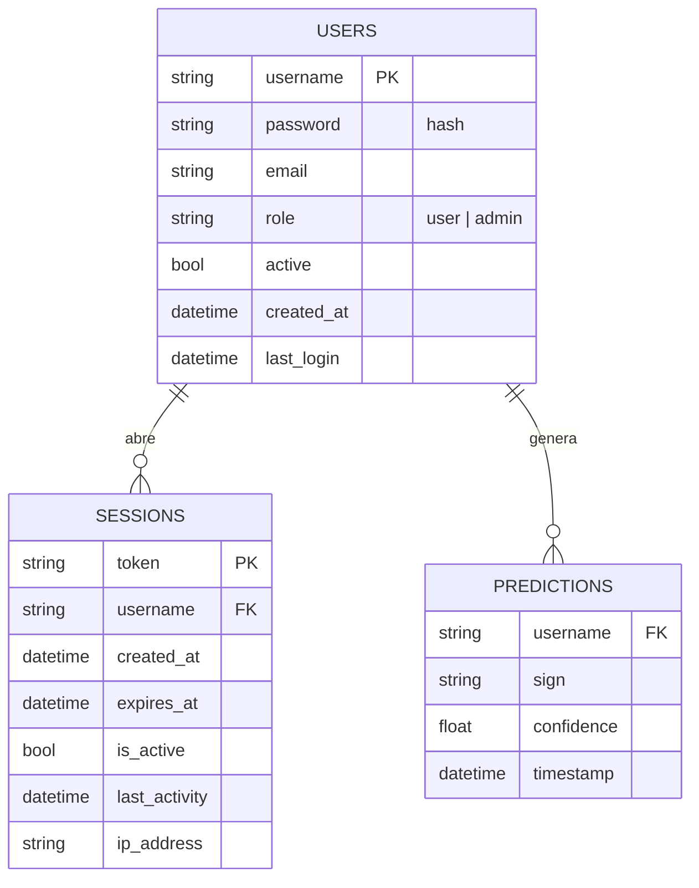

# Modelo de datos: SignIA

Extraído de la sección 6 de `arquitectura_y_modelo_de_datos.md` (carpeta Aplicación). Diagrama: `diagramas/07_modelo_datos.png`.

Tablas DuckDB: en MotherDuck cuando hay token, o archivos Parquet en `data/` en modo local. El esquema es el mismo en ambos casos.

Correcciones del Sprint 3:
- `PREDICTIONS` se declaró en `COLUMNS_MAP` y se guarda con `append_data`, que agrega filas en vez de reemplazar el archivo.
- La vista de estadísticas lee la tabla `predictions`.
- `password` usa PBKDF2-SHA256 con sal (`pbkdf2_sha256$iteraciones$sal$hash`); los hashes SHA-256 antiguos siguen siendo válidos.
- El dataset ahora incluye la columna `person` para evaluar con personas nuevas (las muestras de la versión 1.0 quedan como `equipo_v1`).

